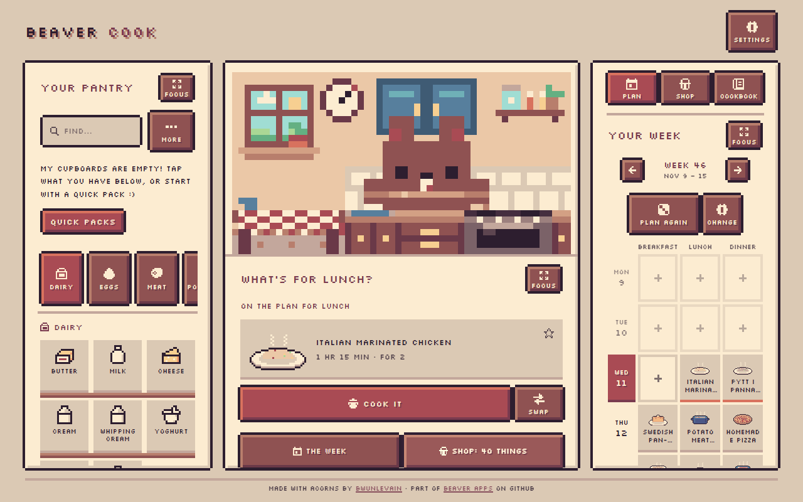
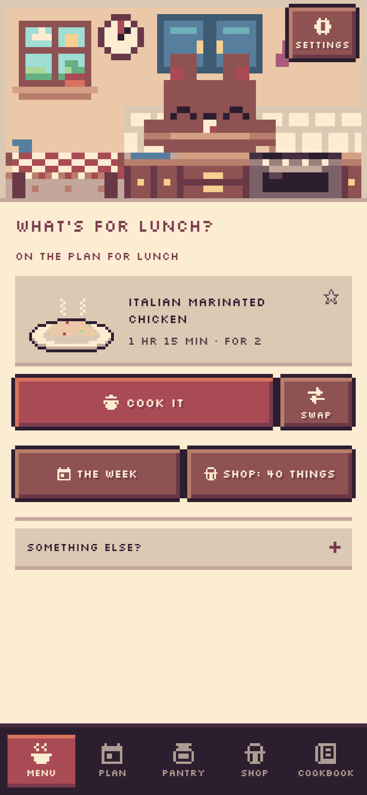
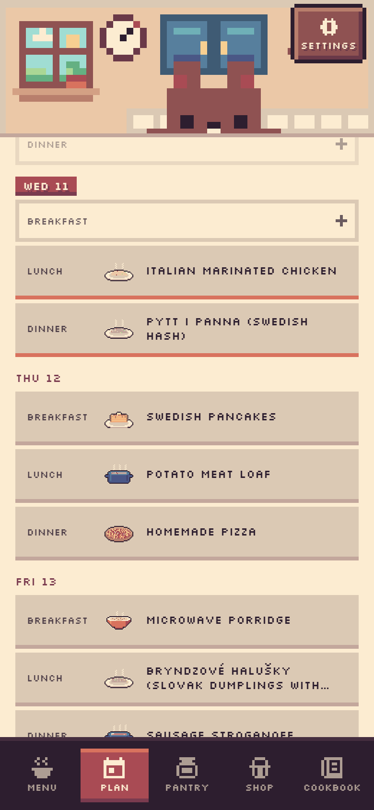
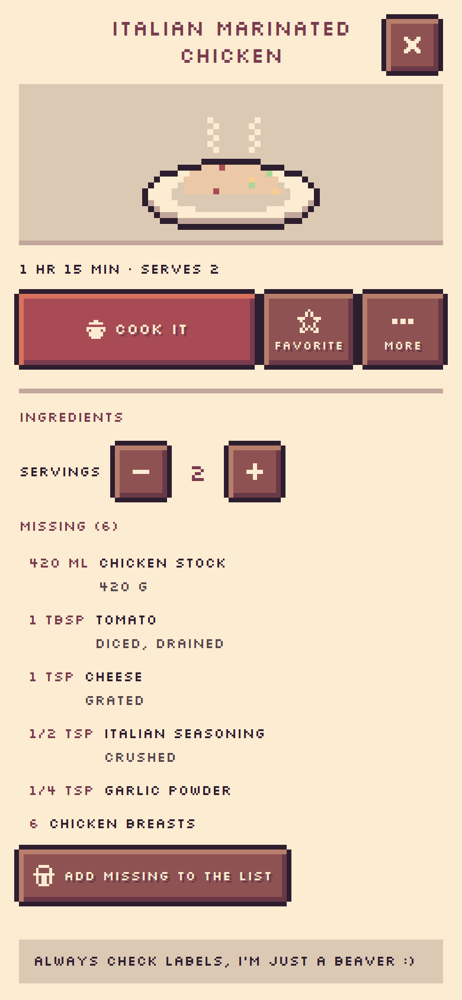
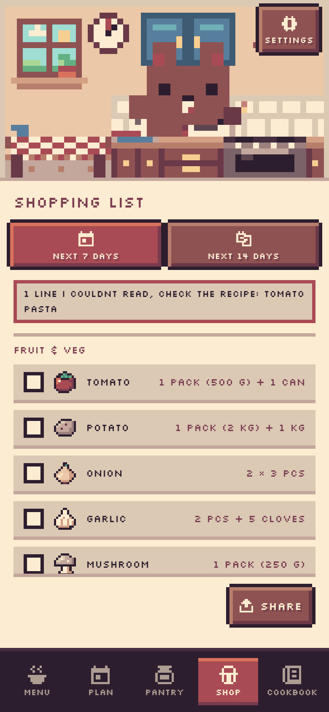

  

<h1 align="center">Beaver Cook</h1>

<b><a href="https://beaver-apps.github.io/cook/">Open Beaver Cook</a></b> · beaver-apps.github.io/cook/

  <b>A tiny pixel beaver who looks in your cupboards and plans what we cook.</b> 
  Try it at <a href="https://beaver-apps.github.io/cook/">beaver-apps.github.io/cook</a>

  

---

## I'm brand new, please be gentle :)

Beaver Cook is a **new, early app**. I only just moved into my kitchen, so things will change, some things will
wobble, and a few corners are still bare. If something is confusing, broken or missing, please
[tell me in an issue](https://github.com/beaver-apps/cook/issues). I read every one, and your feedback is how I get better.

## Hi, I'm the beaver :)

You might know me from Beaver Reader and Beaver Focus. This is my third job: I'm the cook. Tell me what is in your
cupboards (or don't, I can guess) and I'll say what we can make. Then I'll plan the whole week, so the shopping list
is short, cheap and has something everyone at the table can eat. I stand in my kitchen the whole time, stirring and
tasting and sometimes falling asleep at the table. Cooking is better with a buddy, specially one with a ladle.

  
  &nbsp;
  
  &nbsp;
  

## What I do

### What's for the meal at hand

- **The Menu tab** answers "what shall we cook?" for the meal you're at. If it's on your plan, it's the first card,
  with **Cook it** and **Swap**. If it isn't, I look at what you have and suggest dishes, and say what each one is missing.
- **Recipes open inside the app**, with a pixel picture of the dish. Change the **servings** and the amounts change with them.
  Metric or US units, as you choose in Settings.
- **Cook mode** takes you one step at a time. Times in the steps ("simmer for 10 minutes") turn into timers you tap,
  and several can run together. The screen stays awake, and I cook along in my kitchen. When you're done I ask what
  to take out of the pantry.
- **Favourites** get a star, and the Cookbook keeps **what you cooked recently**.

### Your pantry

- **Shelves with pictures** for dairy, eggs, meat, vegetables, spices and more. Tap what you have, or search by name.
- **Paste a list** ("2 onions, rice, half a cabbage") and I turn it into pantry items.
- **Things you always have** (salt, oil, water...) never stop a recipe.
- You don't have to fill it in. What you put away from the shopping list lands here by itself.

### The week

- **Plan** is a week board with breakfast, lunch and dinner, each of them on or off. Put a dish on a day yourself, or
  press **Plan my week** and I fill in the empty slots. I never touch what you put in, and I plan around it.
- **Several dishes per meal** if you like a main and a side.
- **Meal prep boxes**: cook a big batch once and have it for the next few lunches.
- **People** with their own tastes. Say who is eating, add what someone is allergic to, what their diet is, and what
  they don't eat. I plan only dishes everyone at that meal can have.
- I plan for **few things to buy**, so I reuse ingredients across the week.

  

### The shop

- **The list comes from your week**: what the plan needs, minus what is already in your pantry, in whole packs, grouped
  by where it is in the shop.
- **Put it away** moves what you ticked into your pantry. Pressed it too early? **Undo** puts everything back.
- Add your own things, and **share** the list as plain text.

### Recipes and who made them

- **About 6,800 recipes** in many languages, every one openly licensed or in the public domain: Wikibooks
  cookbooks, Public Domain Recipes, HowToCook, and more.
- **60 Beaver Cook originals** in Swedish and English, written by me for this app (CC BY-SA 4.0).
- **Every recipe credits who made it**, with a link to the source and its licence. I tidy the steps, so I say that too.
- Recipes show **allergen and diet labels**, and a note on every recipe page: *check the labels, I'm just a beaver :)*.
  I try my best, but I can get it wrong, so please always read the packet.

### And also

- **Languages.** I speak English, Svenska, Dansk, Norsk, Suomi, Deutsch, Español, Français, 中文 and 日本語.
  Ingredients and amounts follow the app's language.
- **Phone, tablet or computer.** Install it to your home screen or desktop and it works offline. Phones get tabs
  at the bottom (Menu, Plan, Pantry, Shop, Cookbook); computers get three columns.
- **Light and dark**, and calmer motion if your device asks for it.

## Your data stays with you

Everything lives on your device: your pantry, your plan, your people, what you cooked and your settings. No account,
no ads, no tracking, and no server of mine that sees it. The recipes come with the app, so I don't have to ask anyone
for them either.

Want to move to another device, or just keep a copy? **Settings** can save a **backup file** and load it again.
Clearing your browser's site data erases it all, so a backup now and then is a good idea.

## Versions

Every update has a name. The first one is **v0.1 "First Nibble"**: the beaver moves into his kitchen. The app shows
all the versions and their notes under **Settings**, and the full list is in
`src/core/releases.js`.

## About this repo

This repo holds the ready-to-use Beaver Cook that runs at https://beaver-apps.github.io/cook/ (just the built files).
The source code is private for now.

## License

Copyright 2026 BwunLevain (https://github.com/BwunLevain). The app's code is under the
[PolyForm Noncommercial License 1.0.0](LICENSE.md): you can use it, change it and share it for any noncommercial
purpose, but not sell it. The beaver and the pixel art are mine, so please don't reuse them in other projects.

The recipes keep their own licences, listed in the app and on every recipe (mostly CC BY-SA 4.0, plus Unlicense and
other open licences). My 60 originals are CC BY-SA 4.0. The pixel font Silkscreen is by The
Silkscreen Project Authors, under the [SIL Open Font License 1.1](fonts/OFL.txt).

 Now go see what's in your fridge. I'll put the kettle on.

